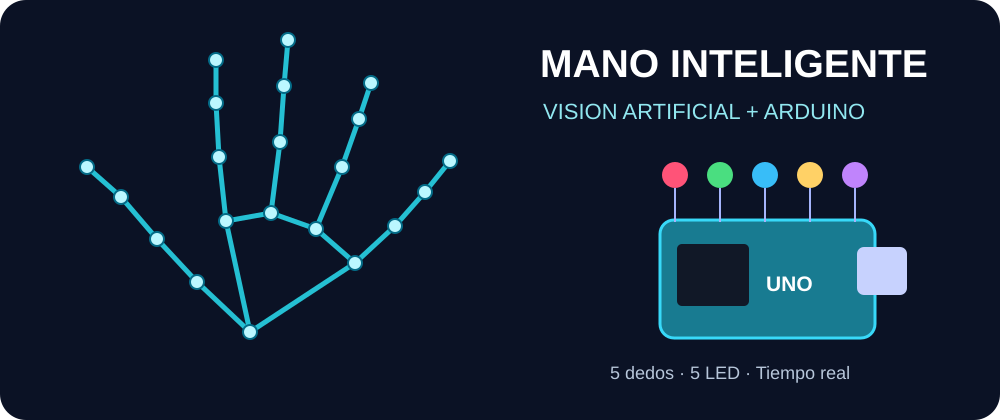
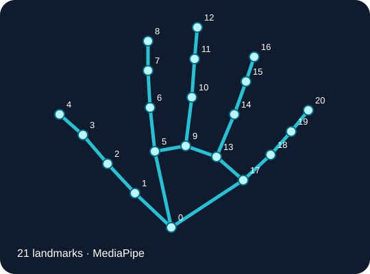
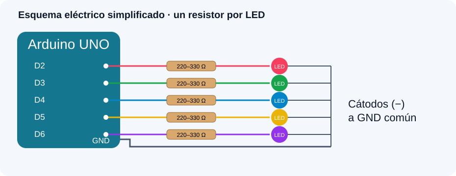
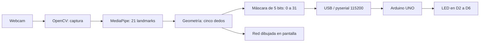

# 🖐️ Mano inteligente · Visión artificial + Arduino UNO

<p align="center"></p>

<p align="center">


</p>

**Cinco dedos, cinco LED.** Una cámara reconoce qué dedos levantas y Python envía un comando serial al Arduino para encender los LED correspondientes. En la pantalla aparece la mano con una **red de 21 puntos** conectados en tiempo real.

> 📷 Las ilustraciones SVG incluidas en `docs/img/` son diagramas originales, no capturas de una prueba real. Puedes reemplazarlas o añadir un GIF de tu montaje.

## ✨ Demostración lógica

| Gesto | LED encendidos | Máscara enviada |
|---|---|---|
| ✊ Puño cerrado | Ninguno | `0` |
| ☝️ Índice | D3 | `2` |
| 🖕 Solo medio | D4 | `4` |
| ✌️ Índice + medio | D3 y D4 | `6` |
| 🖐️ Mano abierta | D2, D3, D4, D5, D6 | `31` |

La correspondencia es **pulgar → D2**, **índice → D3**, **medio → D4**, **anular → D5**, **meñique → D6**. El sistema identifica la combinación de dedos: no se limita a contar cuántos hay levantados.

## 🧠 ¿Qué modelo utiliza?

[MediaPipe Hand Landmarker](https://ai.google.dev/edge/mediapipe/solutions/vision/hand_landmarker/python), un modelo preentrenado de detección y seguimiento de manos. Entrega 21 *landmarks* (coordenadas anatómicas) por mano. **No entrenamos una red neuronal propia**: sobre esos puntos, el proyecto utiliza reglas geométricas (ángulos y distancias) para estimar si cada dedo está extendido. OpenCV gestiona la cámara y dibuja la red; pyserial comunica Python con Arduino a **115200 baudios**.

<p align="center"></p>

**Limitación:** el reconocimiento puede fallar con manos giradas, dedos parcialmente ocultos o pulgar extendido lateralmente. Los umbrales del script son un punto de partida, no un clasificador infalible.

## 🧩 Materiales

- Arduino UNO o compatible y cable USB de datos.
- 5 LED y **5 resistencias de 220–330 Ω** (una por LED).
- Protoboard y cables jumper.
- Computador con cámara y Arduino IDE.
- Python compatible con las versiones de MediaPipe de tu sistema. **Se recomienda Python 3.10–3.12**, de 64 bits, cuando haya disponibilidad de ruedas para tu arquitectura; el proyecto también se ha estructurado para el entorno 3.9 usado originalmente, sujeto a compatibilidad de paquetes.

## 🔌 Montaje

<p align="center"></p>

| Dedo | Pin digital | Cableado |
|---|---|---|
| Pulgar | D2 | D2 → resistencia → ánodo (+) LED 1; cátodo (−) → GND |
| Índice | D3 | D3 → resistencia → ánodo (+) LED 2; cátodo (−) → GND |
| Medio | D4 | D4 → resistencia → ánodo (+) LED 3; cátodo (−) → GND |
| Anular | D5 | D5 → resistencia → ánodo (+) LED 4; cátodo (−) → GND |
| Meñique | D6 | D6 → resistencia → ánodo (+) LED 5; cátodo (−) → GND |

⚠️ **Nunca conectes los LED sin resistencias.** Usa el GND del mismo Arduino; no se requiere batería externa para estos cinco LED comunes.

## 🗂️ Estructura del repositorio

```text
vision_mano_arduino/
├── README.md
├── requirements.txt
├── .gitignore
├── vision_mano.py                 # Cámara, reconocimiento y puerto serie
├── arduino/
│   └── vision_mano_arduino.ino    # Firmware de los cinco LED
├── docs/
│   └── img/
│       ├── banner.svg
│       ├── landmarks.svg
│       └── circuito.svg
└── hand_landmarker.task          # Se descarga (no viene en el ZIP)
```

El entorno `.venv/` y el modelo `.task` se generan/descargan en tu equipo. Evita subir `.venv` a GitHub.

## 🚀 Instalación desde cero

### 1. Preparación compartida

Instala [Python](https://www.python.org/downloads/), [Arduino IDE](https://www.arduino.cc/en/software) y conecta el Arduino al USB. Descarga o descomprime esta carpeta. Abre una terminal **dentro de `vision_mano_arduino/`**. En Arduino IDE abre `arduino/vision_mano_arduino.ino`, selecciona placa/puerto y pulsa **Subir**. Luego cierra **Monitor Serie** y **Plotter Serie**.

### 2A. Windows (PowerShell)

```powershell
cd ruta\a\vision_mano_arduino
py -3 -m venv .venv
.\.venv\Scripts\Activate.ps1
python -m pip install --upgrade pip
python -m pip install -r requirements.txt
curl.exe -L "https://storage.googleapis.com/mediapipe-models/hand_landmarker/hand_landmarker/float16/1/hand_landmarker.task" -o hand_landmarker.task
python -m serial.tools.list_ports
python vision_mano.py --port COM3
```

Reemplaza `COM3` por el puerto listado en tu PC. Si PowerShell bloquea la activación, usa una terminal CMD con `.venv\Scripts\activate.bat`, o ejecuta `.venv\Scripts\python.exe` sin activar el entorno.

### 2B. macOS (Terminal)

```bash
cd /ruta/a/vision_mano_arduino
python3 -m venv .venv
source .venv/bin/activate
python -m pip install --upgrade pip
python -m pip install -r requirements.txt
curl -L "https://storage.googleapis.com/mediapipe-models/hand_landmarker/hand_landmarker/float16/1/hand_landmarker.task" -o hand_landmarker.task
python -m serial.tools.list_ports
python vision_mano.py --port /dev/cu.usbserial-21420
```

💡 **En el Mac usado durante el proyecto, el puerto identificado fue `/dev/cu.usbserial-21420`.** Es importante respetar el guion y usar `usbserial`, **no** `usbmodem`. Este número puede variar cuando reconectes Arduino. Autoriza a Terminal o tu editor para usar la cámara en **Configuración del Sistema → Privacidad y seguridad → Cámara**.

### 2C. Linux (Terminal)

```bash
cd /ruta/a/vision_mano_arduino
python3 -m venv .venv
source .venv/bin/activate
python -m pip install --upgrade pip
python -m pip install -r requirements.txt
curl -L "https://storage.googleapis.com/mediapipe-models/hand_landmarker/hand_landmarker/float16/1/hand_landmarker.task" -o hand_landmarker.task
python -m serial.tools.list_ports
python vision_mano.py --port /dev/ttyUSB0
```

Algunas placas aparecen como `/dev/ttyACM0`. Si hay errores de permisos, comprueba los grupos del dispositivo; en distribuciones que usan `dialout`, ejecuta `sudo usermod -aG dialout "$USER"` y vuelve a iniciar sesión. Algunas distribuciones requieren `sudo apt install python3-venv`.

> 📦 Si `pip` muestra **No matching distribution found** para MediaPipe, revisa versión de Python, arquitectura (64 bits) y disponibilidad del paquete para tu sistema. Prueba Python 3.11 en un entorno nuevo. Las versiones mínimas del `requirements.txt` no garantizan disponibilidad en todas las plataformas.

### 3. Arrancar de nuevo en otro momento

Después de la primera instalación solo necesitas abrir la carpeta, activar `.venv` (cuando corresponda) y ejecutar:

```bash
python vision_mano.py --port /dev/cu.usbserial-21420
```

En Windows sustituye el puerto por `COM3`; en Linux por el tuyo. Puedes omitir `--port` **si se detecta un único puerto USB compatible**. Presiona **Q** en la ventana de cámara para cerrar.

## 🔄 Arquitectura de funcionamiento



Cada bit de la máscara significa un LED. Ejemplo: `4` es binario `00100` → solo dedo medio, LED D4. `31` es `11111` → cinco LED. Python transmite al detectar cambios y reenvía periódicamente; Arduino apaga los LED si no recibe mensajes durante 1,5 segundos.

## 🧪 Diagnóstico paso a paso

1. **Prueba el hardware:** Arduino debe tener cargado el `.ino` proporcionado, no un sketch de parpadeo previo.
2. **Comprueba el puerto:** `python -m serial.tools.list_ports`.
3. **Cierra el Monitor Serie y el programa de visión** antes de abrir el puerto desde otro proceso.
4. **Prueba LED desde Python**, con el puerto correcto:

```bash
python -c "import serial,time; s=serial.Serial('/dev/cu.usbserial-21420',115200); time.sleep(2); s.write(bytes([31])); time.sleep(3); s.write(bytes([0])); s.close()"
```

Cambia el puerto si usas Windows o Linux. Los cinco LED deberían encenderse tres segundos y luego apagarse. **Si la cámara detecta pero los LED no encienden**, primero verifica la prueba serial, polaridad, resistencia y GND. Si Python informa *No se pudo abrir el puerto*, la aplicación continuará en modo cámara sin LED.

5. **No se ve la mano:** revisa permisos, iluminación, cámara conectada y `--camera 1` si hay más de una.
6. **Modelo ausente:** revisa que `hand_landmarker.task` se haya descargado en la raíz de esta carpeta.
7. **Dedos mal reconocidos:** separa los dedos, gira la palma hacia la cámara y ajusta umbrales en `fingers_up()`.

## 🔭 Posibles ampliaciones

- Detectar ambas manos y hasta diez LED.
- Añadir animaciones y un panel holográfico.
- Activar servomotores, motores o sonido mediante gestos.
- Grabar GIF o video de demostración para la feria de robótica.

## 📚 Documentación oficial

- [MediaPipe Hand Landmarker en Python](https://ai.google.dev/edge/mediapipe/solutions/vision/hand_landmarker/python)
- [OpenCV](https://docs.opencv.org/)
- [pySerial](https://pyserial.readthedocs.io/)
- [Arduino: Serial](https://docs.arduino.cc/language-reference/en/functions/communication/serial/)

## 📃 Licencia y autoría

Proyecto didáctico basado en herramientas de código abierto. Puedes añadir tu nombre, institución y licencia preferida antes de publicarlo; no se atribuye una licencia automáticamente a las dependencias ni al modelo de terceros.
